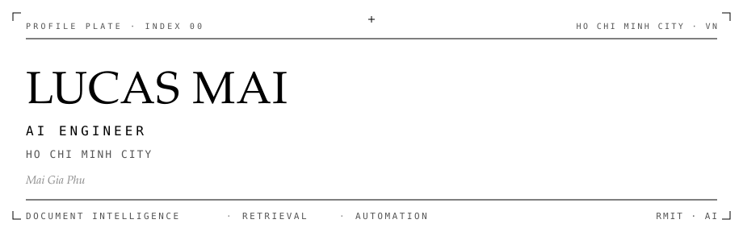
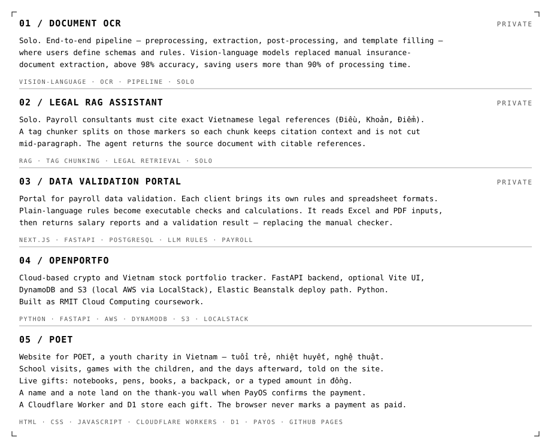
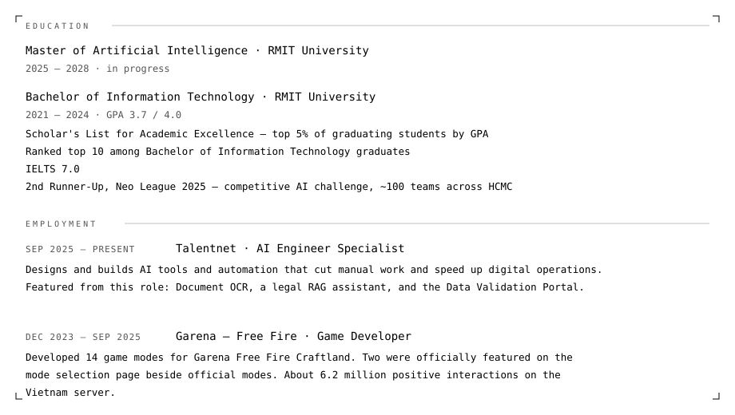

<picture>
  <source media="(prefers-color-scheme: dark)" srcset="assets/dark/header.svg"/>
  
</picture>

 

<a href="https://github.com/maiphh">
  <picture>
    <source media="(prefers-color-scheme: dark)" srcset="https://img.shields.io/badge/GITHUB-0d1117?style=flat-square&logo=github&logoColor=ffffff"/>
    
  </picture>
</a>
<a href="https://www.linkedin.com/in/phumai29/">
  <picture>
    <source media="(prefers-color-scheme: dark)" srcset="https://img.shields.io/badge/LINKEDIN-0d1117?style=flat-square&logo=linkedin&logoColor=ffffff"/>
    
  </picture>
</a>
<a href="mailto:maiphh29@gmail.com">
  <picture>
    <source media="(prefers-color-scheme: dark)" srcset="https://img.shields.io/badge/EMAIL-0d1117?style=flat-square&logoColor=ffffff"/>
    
  </picture>
</a>

<picture>
  <source media="(prefers-color-scheme: dark)" srcset="assets/dark/s01.svg"/>
  
</picture>

<picture>
  <source media="(prefers-color-scheme: dark)" srcset="assets/dark/profile.svg"/>
  
</picture>

<picture>
  <source media="(prefers-color-scheme: dark)" srcset="assets/dark/s02.svg"/>
  
</picture>

<picture>
  <source media="(prefers-color-scheme: dark)" srcset="assets/dark/work.svg"/>
  
</picture>

  <a href="https://github.com/maiphh/openportfo"><strong>openPortfo</strong></a>
  ·
  <a href="https://github.com/maiphh/poet"><strong>POET</strong></a>
  ·
  Document OCR <em>Private</em>
  ·
  Legal RAG <em>Private</em>
  ·
  Data Validation Portal <em>Private</em>

<picture>
  <source media="(prefers-color-scheme: dark)" srcset="assets/dark/s03.svg"/>
  
</picture>

<picture>
  <source media="(prefers-color-scheme: dark)" srcset="assets/dark/record.svg"/>
  
</picture>

<picture>
  <source media="(prefers-color-scheme: dark)" srcset="assets/dark/s04.svg"/>
  
</picture>

<picture>
  <source media="(prefers-color-scheme: dark)" srcset="assets/dark/tools.svg"/>
  
</picture>

<picture>
  <source media="(prefers-color-scheme: dark)" srcset="https://github-readme-stats.vercel.app/api?username=maiphh&show_icons=true&hide_border=true&bg_color=00000000&title_color=ffffff&text_color=ffffff&icon_color=ffffff"/>
  
</picture>

<picture>
  <source media="(prefers-color-scheme: dark)" srcset="https://github-readme-stats.vercel.app/api/top-langs/?username=maiphh&layout=compact&hide_border=true&bg_color=00000000&title_color=ffffff&text_color=ffffff"/>
  
</picture>

<picture>
  <source media="(prefers-color-scheme: dark)" srcset="https://github-readme-activity-graph.vercel.app/graph?username=maiphh&bg_color=00000000&color=ffffff&line=ffffff&point=ffffff&area_color=ffffff&area=true&hide_border=true&radius=0&custom_title=ACTIVITY"/>
  
</picture>

<picture>
  <source media="(prefers-color-scheme: dark)" srcset="assets/dark/footer.svg"/>
  
</picture>
